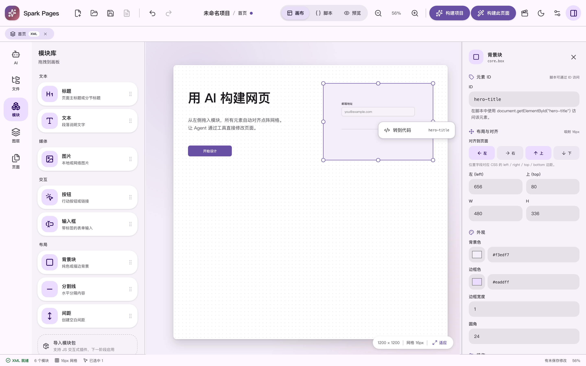
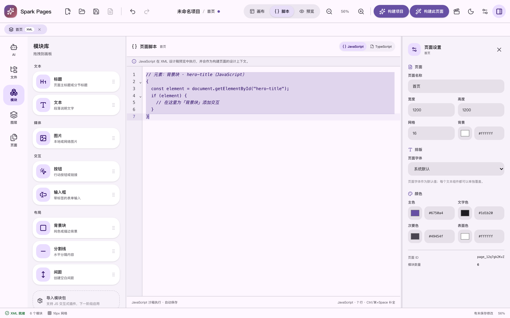
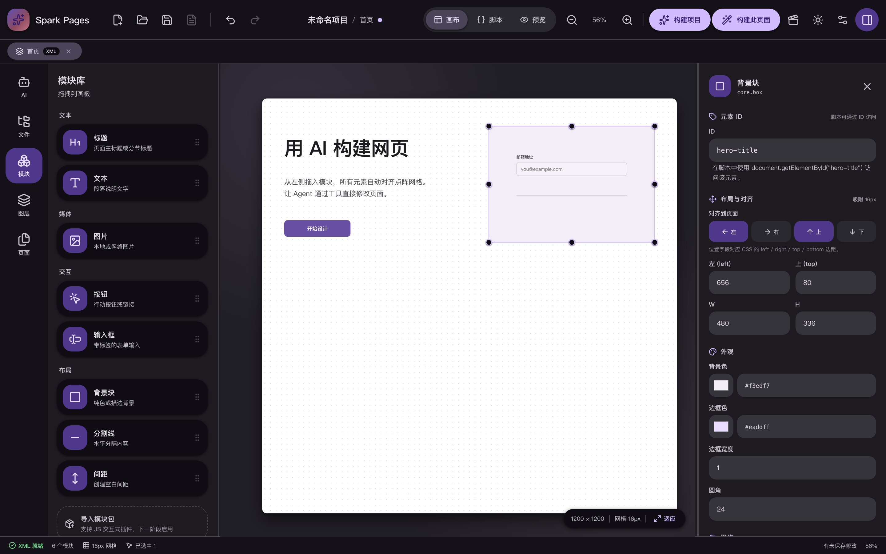

<div align="center">
  

  # Spark Pages

  **XML 驱动的 AI 可视化网页构建器**

  在画布上设计，让 AI 构建真实代码。页面以 XML 保存，设计稿与构建产物分离。

  [](https://tauri.app)
  [](https://react.dev)
  [](https://www.typescriptlang.org)
  [](https://vite.dev)
  [](LICENSE)
  [](#快速开始)

  [功能](#功能) · [快速开始](#快速开始) · [使用流程](#使用流程) · [元素-id-与页面脚本](#元素-id-与页面脚本) · [许可证](#许可证)
</div>



## 是什么

Spark Pages 是一个桌面端可视化网页制作器，把「设计」和「代码」拆成两个清晰的阶段：

- **设计阶段**：在点阵画布上拖拽模块，页面结构保存为可读的 XML，只附加 JavaScript / TypeScript 页面脚本，不写 HTML。
- **构建阶段**：AI Agent 读取页面 XML 与完整项目设置，直接在你的文件夹里生成可运行的 HTML + JS 或 Vue + TS 代码。
- **构建之后**：构建产物作为普通文件标签页打开，提供代码 / 预览 / 脚本三个视图，可继续手改并保存。

所有项目文件都在你自己的文件夹里，不锁定平台。

## 功能

### 设计画布

- 点阵网格、吸附、缩放、适应窗口、画布平移
- 8 个内置模块：标题、文本、图片、按钮、输入框、背景块、分割线、间距
- 拖入、点击添加、单选 / 多选、拖动、8 向缩放、层级调整、复制、删除、撤销 / 重做
- 左 / 右 / 上 / 下边缘对齐，CSS 风格的 `left/right/top/bottom` 锚定边距
- 属性面板按内容、排版、外观、交互、布局分组；标题、文本、按钮、输入框可独立覆盖字体
- 页面级与元素级自定义 ID、页面尺寸、网格、背景色
- 底部动画时间轴：预设出场 / 循环 / 离场动画，以及可编辑的数值关键帧轨道（位移、缩放、旋转、倾斜、透明度、模糊、亮度、饱和度等）

### 多文档标签页

- 标签栏位于标题栏工具栏正下方，页面设计稿与构建产物都是普通标签页
- 可同时打开多个 XML 页面和多个代码文件；支持切换、关闭和未保存提示
- **页面标签页**：画布 / 脚本 / 预览
- **文件标签页**：代码 / 预览 / 脚本，预览直接通过 iframe 渲染构建产物
- 关闭全部标签页后显示空状态，可从左侧页面列表重新打开

| 画布与自定义元素 ID | 页面脚本与“转到代码” |
| --- | --- |
|  |  |

### 元素 ID 与页面脚本

- 每个元素都可以在属性面板设置自定义 ID，不再是随机 ID
- ID 在当前页面内唯一、会作为真实 HTML `id` 输出，预览和构建产物一致
- 画布右键元素 → **转到代码**：自动切换到页面脚本
  - 脚本中已有该元素的代码（`getElementById`、`#id`、`data-spark-module-id`）时直接定位并选中
  - 还没有对应代码时生成一段可直接编辑的起始片段
- XML 设计稿只支持 JavaScript / TypeScript 脚本：
  - JavaScript 在沙箱预览中执行
  - TypeScript 作为构建上下文保存，不在设计预览中直接执行

```js
// 元素：背景块 · hero-title（JavaScript）
{
  const element = document.getElementById("hero-title");
  if (element) {
    // 在这里为「背景块」添加交互
  }
}
```

### 文件夹即工作区

- 顶部 **打开文件夹**：如果根目录有 `.spark` 项目会自动加载，否则基于该文件夹创建项目
- **保存项目**（⌘S）写入 `<项目名称>.spark`
- **保存页面**（⌘⌥S）写入设计目录下的 `page.spark`，与项目文件分开保存
- **构建产物统一输出到 `<项目目录>/build/`**，设计稿（`.spark`、`page.spark`）与构建代码分开存放
- 左侧文件视图可查看目录、文件大小和文本内容，构建完成后自动刷新
- 双击代码文件在文档标签页中打开并可直接保存回磁盘

### AI Agent

- **构建项目** / **构建此页面**：读取页面 XML、完整项目设置、入口与现有文件，通过工具直接写入 `build/`
- 构建提示词会附上每个页面的完整页面脚本（不截断），HTML 项目要求写入 `script.js` 并在页面中引用，Vue 项目要求写入 `<script setup>` 或 `logic.ts`；缺失脚本会构建失败而不是静默生成
- 构建日志展示 AI 文本、每个工具调用、文件路径、大小与内容预览
- **聊天 Agent 默认只读写当前标签页**：
  - 在 `.spark` 设计稿中修改结构、页面设置、主题、动画和页面脚本（保存在 XML 里，不会误改 JS/TS 文件）
  - 在构建产物文件标签中只能读写当前文件
  - 没有打开文档时不调用任何工具，并提示先打开页面或文件
- 内置技能：通用编辑、生成页面、重设计、优化文案、只改选中
- 预览魔杖选中元素后，选区自动附加到下一次 Agent 消息
- 工具修改合并为一次撤销；聊天记录按项目保存
- 兼容 OpenAI 兼容接口，模型需支持 Function Calling / Tools

### 项目类型

| 类型 | 模板 | 构建产物位置（相对 `build/`） |
| --- | --- | --- |
| **HTML + JS** | `static` | `pages/<slug>/`，如 `index.html`、`style.css`、`script.js` |
| **Vue + TS** | `vite-vue-ts` | `src/pages/<slug>/`，如 `index.vue`、`style.css`、`logic.ts` |

旧版 `nodejs` 项目会自动迁移为 Vue + TS。Vue 页面构建会生成每页的 `preview.html` 供应用内预览。

### 其他

- Material Design 3 Expressive 界面，支持跟随系统 / 浅色 / 深色
- 侧栏可拖动调宽并持久化，窄窗口自动切换紧凑布局
- API Key 保存在应用数据目录（macOS：`~/Library/Application Support/com.sparkpages.desktop/ai-keys.json`，权限 `0600`），不写入项目文件
- 本地自动恢复草稿，主题选择只保存在本机

<div align="center">
  
</div>

## 快速开始

环境要求：

- Node.js 20+
- Rust stable
- macOS 需要 Xcode Command Line Tools；Linux 需要 WebKitGTK 等 Tauri 依赖；Windows 需要 WebView2

```bash
git clone https://github.com/YurizonoMika/spark-pages.git
cd spark-pages
npm install
npm run tauri dev
```

仅启动前端（浏览器中调试 UI，文件与 AI 能力不可用）：

```bash
npm run dev
```

打包桌面应用：

```bash
npm run tauri build
```

产物位于 `src-tauri/target/release/bundle/`。

## 使用流程

1. **打开文件夹**：选择一个空目录，或包含 `.spark` 项目文件的目录。
2. **设计页面**：从左侧模块库拖入元素，用属性面板调整布局、样式和动画。
3. **添加脚本（可选）**：在画布右键元素选择“转到代码”，或直接切到脚本视图编写 JS/TS。
4. **配置模型（可选）**：在模型设置中填写 OpenAI 兼容 Base URL、模型名和 API Key。
5. **构建**：点击“构建此页面”或“构建项目”，AI 将页面 XML 转换为真实代码文件。
6. **继续编辑**：在文件标签页的代码视图修改构建产物，⌘S 保存；预览视图即时查看结果。

## AI 配置

- 支持任何 OpenAI 兼容的 `/chat/completions` 接口
- 模型需要支持 Function Calling / Tools；不支持时会回退为一次性 JSON 文件结构生成
- API Key 由应用保存在本机数据目录，不写入项目，也不会回传到前端
- 每次构建都会附带项目名称、说明、类型、模板、主题、页面清单与页面 XML

## 项目结构

```text
src/
  components/    顶栏、标签栏、画布、侧栏、属性面板、预览、代码编辑器、文件树
  store/         编辑器状态、多文档标签、撤销/重做、主题、聊天记录
  model/         页面、模块、主题、动画与关键帧数据模型
  modules/       模块注册表与内置模块实现
  xml/           XML 解析、序列化与兼容迁移
  lib/           几何吸附、HTML 渲染、脚本定位、文件与转义工具
  lib/ai/        模型请求、Agent 工具、项目 / 页面构建、页面文件工具
  styles.css     Material Design 3 主题与全部界面样式
src-tauri/       Tauri 后端、文件命令、密钥存储、模型代理
docs/screenshots README 截图
build/           AI 构建产物（运行时生成，不进入版本库）
```

## 技术栈

| 层 | 技术 |
| --- | --- |
| 桌面外壳 | Tauri 2（Rust） |
| 前端 | React 19 + TypeScript 6 + Vite 8 |
| 状态 | Zustand + Immer |
| 代码编辑 | CodeMirror 6 |
| Markdown | react-markdown + remark-gfm |
| 测试 | Vitest（前端）、cargo test（Rust） |

## 测试与检查

```bash
npm test                 # Vitest
npm run build            # TypeScript 类型检查 + Vite 构建
cd src-tauri
cargo fmt --check
cargo clippy -- -D warnings
cargo test
```

## XML 示例

```xml
<spark-pages version="1" name="示例项目" type="html" template="static">
  <theme primary="#6750a4" text="#1d1b20" surface="#ffffff" />
  <page id="page_home" width="1200" height="900" grid="16" background="#ffffff">
    <module id="hero-title" type="core.heading" x="80" y="120" width="640" height="96">
      <props>
        <text><![CDATA[用 AI 构建网页]]></text>
      </props>
    </module>
    <custom-script language="javascript"><![CDATA[
      document.getElementById("hero-title")?.addEventListener("click", () => {
        console.log("clicked");
      });
    ]]></custom-script>
  </page>
</spark-pages>
```

更多约定见源码中的 `src/xml/projectXml.ts` 与测试。

## 路线图

- [ ] 插件包导入、沙箱运行时与插件管理
- [ ] AI 构建页面的二次魔杖编辑
- [ ] 更多内置模块与模板

## 许可证

本项目采用自定义的 **Spark Pages License 1.0**，详见 [LICENSE](LICENSE)。这是一个 **源码可见（source-available）** 许可证，不是 OSI 认可的开源许可证：

- ✅ 个人、教育、研究与非营利使用
- ✅ 修改与分发，但必须 **注明出处** 并保留原项目链接
- ✅ 衍生作品必须继续开源，**禁止闭源分发**
- ✅ 可提供付费服务（设计、定制、集成、部署、咨询、培训、支持、维护）
- ❌ 未经授权不得将本软件或其衍生作品用于商业产品，或以软件本身为核心提供多租户托管服务
- ❌ 不得将本软件或衍生作品作为独立产品 / 模板产品销售

商业授权请联系仓库作者。使用或分发本项目即表示你接受该许可证条款。

---

<div align="center">
  Built with Tauri, React and a lot of XML.
</div>
